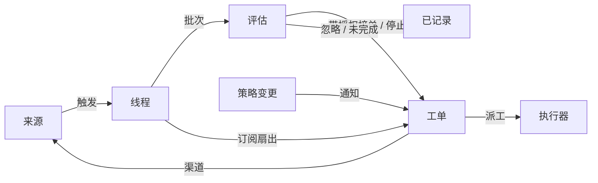

# 001 领域模型

[English](../001-domain.md) | **简体中文**

本文命名 dsh-superagent 的概念，以及每个概念所遵守的规则。代码、智能体调用的工具、面板和其他文档都使用这些术语，不使用其他术语。遵循 [000 理念](000-philosophy.md)，模型只包含工作所需的概念，而一个业务需求会成为其中某个概念的属性。

## 流程

工作从触发（Trigger）流向评估（Eval），再流向执行。来源（Source）产生触发。触发作为上下文扇出（fan-out）到订阅了其线程（Thread）的工单（Ticket）。以这种方式到达某个工单的人的消息会留在该工单；其他每个触发都进入评估，由评估决定是否请求新的工作。评估接受时，会创建一个带有授权（Mandate）的工单。派工（Assignment）把工单交给执行器（Executor），结果通过渠道（Channel）回到来源。

## 概念

来源、线程、评估、授权和订阅（Subscription）构成核心领域；其余概念支撑它们。

| 概念 | 定义 | 遵守的规则 | 存在的原因 |
| --- | --- | --- | --- |
| Source | 一个事件流。来源类型是可复用的实现；来源实例是某个类型的一份配置：它是否运行，以及它监听什么 | 保存自己的读取位置和自己的机器人身份。定义什么算一个事件，包括只在持续一段时间后才成立的条件。在进入领域之前，丢弃机器人自己的消息，以及不在其监听范围内的触发。把每个触发转换为其所属的线程，以及用于回复的渠道地址 | 重启不得重放事件 |
| Trigger | 一个不可变事件，带有来源自己的元数据，例如其发起者 | 属于一个或多个线程。同一个触发被接受两次只创建一个工单 | 审计与幂等的单位 |
| Thread | 按时间排序的触发；由来源定义哪些触发构成一个线程 | 同一时间最多有一个评估在其上运行。它可以有多个工单。它保存自己的订阅、正在运行的评估及其决定（Decision）历史 | 为评估提供一致的视图和上下文 |
| Correlation | 一个触发所属的多个线程之间的关系 | 只增加上下文；从不路由 | 让评估能追踪相关证据 |
| Channel | 线程的写入侧；其地址由来源定义 | 一个线程可以有多个渠道；一个工单持有一组渠道 | 确认、回复、pull request 和已解决的评审都是写入 |
| Policy | 带版本的研判规则，以及每个来源的那一部分：谁可以通过该来源、以该来源自己的身份发起工作，名单如何同步，以及哪些机器人可以产生候选 | 策略版本涵盖规则、接单模式和来源部分。影响活动工单的变更，例如其接单时所依据的某条规则发生变更，会投递到它的派工；但不会撤销授权。不同来源上的身份永远不会互相映射 | 规则变化时，正在运行的评估必须被丢弃 |
| Eval | 对一批触发的判断，分两层：准入（Gate）和研判（Assessment） | 输入：触发的批次、线程快照、该线程上的每个工单（包括已结束的），以及当前策略。输出：一个决定。不保存状态 | 决定新工作是开始、继续还是停止 |
| Mandate | 接单所授予的内容：策略版本、范围、强度、匹配的规则、发送者在对应来源上的身份，以及来源接收该触发的方式 | 不可变；范围更大意味着新工单。工单结束不会结束授权：只有人的停止会撤回它，而不再支持它的策略会撤销它。已结束的工单恢复之前，会依据当前策略重新校验 | 说明工作为何可以做，以及可以做到什么程度 |
| Ticket | 一个获授权工作的单位 | 只有评估会创建工单。引用其授权；持有其渠道和输入（Input）。状态从 open → ended，当人在其某个线程上发的消息使其恢复时回到 open，除非人已将其停止。定义自己的状态，而不是跟随执行器的状态 | 拥有执行及其报告 |
| Assignment | 工单与一个执行器实例的绑定 | 一个工单在一段时间内会有多个派工。状态独立于工单地从 pending → running → ended。只有其最终报告可以在执行器一侧结束工单 | 执行器在领域之外，但「谁在执行」必须在领域之内 |
| Subscription | 工单与线程之间的多对多关系，由线程持有 | 匹配的触发会扇出到每个活动且已订阅的工单，不检查是谁发送的；以这种方式到达某个工单的人的消息不经过评估。执行器为获取上下文而关注的线程也会以同样方式到达其工单，但不赋予它任何权限，也不会使其恢复。已结束的工单保留其订阅，包括已关闭或已合并的 pull request 的订阅：人的消息会在同一授权下使其恢复，无需评估或决定；来自机器人和 CI 的消息不会到达它，因为其执行器在恢复时会重新读取它的线程。被人停止的工单什么都不接收。主 Session 只有在消息明确指向某个既有工单时，才会把线程附加到该工单。人可以移除线程上的每个订阅；执行器只能移除自己工单对某个它认为无关的线程的订阅，但其工单起始所在的线程，以及来源让它关注的线程除外，例如其 pull request 的线程 | 后续讨论无需任何人再次提及智能体就能到达执行器 |

人不是一个领域概念。触发携带来源所给出的发起者标识符。允许名单是策略中属于某个来源的部分，使用该来源上的身份。同一个人在多个来源上都有账号，这一点是提示词文本，智能体在需要时读取它。

执行器及其 Session 和目录在领域之外，通过派工与领域相连。

聚合：来源持有其读取位置。线程持有其订阅、正在运行的评估（它串行运行，并把期间到达的触发合并到下一批），以及其决定历史。工单持有其派工、渠道和输入，并通过 id 引用决定。

## 被否决的概念

| 被否决的概念 | 原因 |
| --- | --- |
| 把 Principal 或 Membership 作为实体，或跨来源映射身份 | 人是触发的元数据；允许名单是策略中属于某个来源的部分；跨来源映射是提示词文本 |
| 由评估调度自己的延迟触发 | 需要等待的条件是一个普通来源，因此评估从不反过来依赖来源 |
| 等待中或已撤销的评估状态 | 等待属于来源；超时的评估会重新把其触发排队，或以 `unavailable` 结束 |
| 每个线程最多一个活动工单 | 一个线程可以承载多项独立工作；研判借助工单列表避免重复 |
| 一种「追加到工单」的决定 | 追加就是订阅扇出，不需要评估 |
| 对订阅做准入检查 | 订阅覆盖整个线程；授权机制把授权与上下文分开 |
| 会进行路由的关联 | 订阅负责路由；关联只增加上下文 |
| 跟随 DSH Session 的工单状态 | 工单可以被移交、恢复，或由多个执行器运行，因此它定义自己的状态 |
| 执行器宣称有人要求它停止 | 只有评估决定结束的强度 |
| 策略变更时取消运行中的工单 | 取消变更会留下半完成的工作；改为记录并投递该变更 |
| 在执行器 Session 失败或受阻时锁定它的所有工具 | 这会拒绝人在该 Session 中直接工作，也会拒绝恢复后的报告；暂停自动输入就足够了 |
| 从报告的自由文本推断「在等人」 | 分类需要结构化事实；执行器通过结构化字段来提问 |

## 可复用的部分

上述概念及其规则是可复用的。来源实现、策略内容、执行器和渠道实现属于某个部署。每个来源在内部保留自己的说法，例如 message、chat 或 notification，并把它们转换为触发。

| 部分 | 在本仓库中 |
| --- | --- |
| Source | 飞书：发给机器人的实时消息事件和回复。GitHub：通知、已订阅的 Issue 和 pull request、CI 变更、已合并或关闭的 pull request，以及在开启时，仓库中的每个新 Issue、pull request 和评论，以及默认分支的 CI。GitLab：项目中的 Issue、合并请求、note 和流水线变化，以及已合并或关闭的合并请求（在开启时） |
| Policy | 研判规则，以及每个来源的允许名单、其同步、其机器人列表及其准入表 |
| Executor | 一个 DSH 执行器 Session，以及每个工单一个目录，位于执行环境（Execution environment）中，其变量由执行器和来源注册 |
| Channel | 飞书话题回复、GitHub 评论和评审线程回复 |

## 术语表

本文件及后续文档所用术语的参考列表，附其中文名称；后续文档会解释上面未介绍的术语。面板一次只显示一种语言；它的 (?) 按钮会打开同时显示两种语言的这份术语表。智能体在 GitHub、GitLab 和飞书上发给人的消息使用平实的语言，不使用这些术语。

| Term | 中文 | 含义 |
| --- | --- | --- |
| Agent | 智能体 | dsh-superagent 运行的自动化团队成员，通过 GitHub 账号和飞书机器人等身份在各来源上行动 |
| Main Session | 主 Session | 评估触发、接单、派发工单并进行回复的 DSH Session；在代码和提示词中为 `orchestrator` |
| Executor Session | 执行器 Session | 执行器为单个工单运行的 DSH Session；在代码和提示词中为 `worker` |
| Source | 来源 | 一个事件流：插件提供的一种类型，加上一份实例配置 |
| Trigger | 触发 | 来自来源的一个不可变事件 |
| Thread | 线程 | 按时间排序的触发；同一时间只运行一个评估的单元 |
| Correlation | 关联 | 共享同一个触发的线程之间的关系；它只增加上下文 |
| Channel | 渠道 | 线程的写入侧 |
| Policy | 策略 | 接单所依据的带版本规则，以及其中每个来源的部分，例如谁可以在那里请求工作 |
| Policy version | 策略版本 | 规则、来源部分和接单模式某一组合的标识符；每个授权都会记录它 |
| Eval | 评估 | 把一批触发转化为一个决定的过程 |
| Gate | 准入 | 评估中确定性的第一层：谁可以发起工作，以及以什么强度 |
| Assessment | 研判 | 模型在评估期间作出的判断 |
| Decision | 决定 | 评估的结果 |
| Mandate | 授权 | 接单所授予的内容：强度、范围及其所依据的策略版本 |
| Ticket | 工单 | 一个获授权工作的单位 |
| Assignment | 派工 | 工单与一个执行器实例的绑定 |
| Subscription | 订阅 | 工单与线程之间的关系 |
| Fan-out | 扇出 | 把已订阅线程的触发作为上下文投递给工单 |
| Executor | 执行器 | 运行派工的端口：每个工单一个执行器 Session 和一个目录 |
| Execution environment | 执行环境 | 执行器 Session 和 prepare 命令运行的地方：由执行器和来源注册的变量，每个变量有一个键、一个值和一个描述 |
| Report | 报告 | 派工向其工单报告的状态 |
| Attention | 待人工决定 | 工单上一个等待人回答的问题 |
| Disposition | 去向 | 一个触发被过滤、被评估或被扇出的记录 |
| Input | 输入 | 投递给工单的上下文：扇出的触发、策略变更、恢复和文本 |
| Scope | 范围 | 授权所允许的工作 |
| Strength | 强度 | 一个授权或一次评估的依据有多强 |

| 分组 | 取值 |
| --- | --- |
| Decision | accept 接单 · stop 停止 · ignore 忽略 · unavailable 未完成 |
| Strength | explicit 明确 · inferred 推断 |
| Assignment | pending 待启动 · running 执行中 · ended 已结束 |
| Report | progress 进展 · waiting 等待 · ready 就绪 · blocked 受阻 · failed 失败 · dropped 无需处理 |
