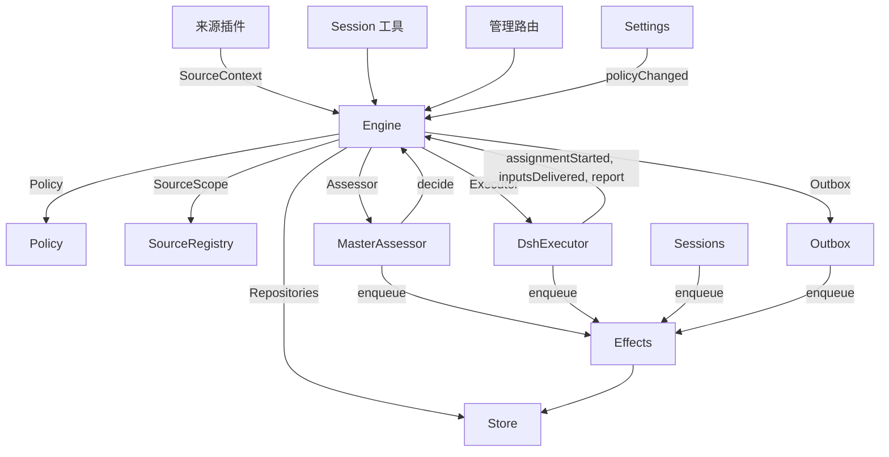

# 007 架构

[English](../007-architecture.md) | **简体中文**

这是实现层的开发者指南。它把 [001 领域模型](001-domain.md) 到 [006 部署](006-deployment.md) 中的概念映射到类、接口和文件。先从运行时和 Engine 开始，然后把模块表和测试表当作代码索引。

## 核心类与胶合层

核心类在小接口背后持有领域概念和外部边界。Glue 把工具参数、HTTP 请求、来源（Source）负载和 DeepSeek Harness 事件转换成对这些类的调用，再把结果变成卡片、视图和消息。

`Runtime`（`src/app/runtime.ts`）构建应用、提供依赖，并负责启动与关停。`Engine` 构造自己的内部部件。执行器（Executor）和 Assessor 会回调 Engine，因此 Runtime 向它们提供 getter，而不要求按环形顺序构造类。

### Runtime

`Runtime` 是组合根；它不包含领域规则。它的构造函数锁定状态目录、打开 Store 并构建每个组件。构造失败时，它关闭 Store 并释放锁。

启动时注册管理路由并运行安装配置（setup）。安装配置完成后，它安装 Session 与执行器钩子，确保主 Session 存在，启动策略（Policy）同步，恢复被中断的派工（Assignment），并启动轮次和副作用。`ready` 标记启动完成。

关停会取消回合、等待轮次、副作用和智能体结束、恢复进程环境、关闭 Store 并释放锁。来源插件通过窄接口 `SourceHost` 把 Runtime 作为 `orchestrator` 服务注入。

| 部件 | 模块 | 作用 |
| --- | --- | --- |
| Setup | `src/app/setup.ts` | 按执行器（worker）shell 运行它们的方式探测各 CLI，以解析仓库和账号，写入并应用 worker 的环境与命令 shim，并保留安装配置问题；Settings 通过它检查变更后的账号，并通过它重启，而重启会再次运行安装配置 |
| Passes | `src/app/passes.ts` | 每两秒一次、以及每当有命令要求时，一次只跑一轮：先处理到期的副作用，再调用 `Engine.evaluateDue`；来源的触发（Trigger）经由它到达 Engine |
| Outbox | `src/app/outbox.ts` | Engine 的 `Outbox` 端口，也是回执的唯一写入者：`send` 在一个事务里保存消息的回执并将其 `reply` 副作用入队，该副作用的处理器再通过 `SourceRegistry.send` 发送它；来源关闭期间消息会等待，会话消失或无人监听时则被丢弃 |
| Notices | `src/app/notices.ts` | 把领域事件和 worker 活动转换成主 Session 消息。`eventNotice` 处理领域通知；`reportRelay` 立即转发问题，把普通进展留在其工单（Ticket）上，并转发其他报告；`followupRelay` 指明拥有人工跟进的工单。回合进行期间到达的转发会通过 DeepSeek Harness 收件箱，在下一步一起投递 |

### Engine

`Engine`（`src/core/engine.ts`）是触发、线程（Thread）、决定（Decision）、工单和派工的唯一写入者。它从 `src/core/ports.ts` 接收这些端口：`Repositories`、一个读取当前策略的 getter、`SourceScope`、`Assessor`、`Executor` 和 `Outbox`。可选依赖是 `prepareTicket`、`now` 和 `emit`。

Engine 的所有方法都是同步的。每个命令在一个事务里修改它的聚合。`evaluateDue` 为它改动的每个评估（Eval）或工单分别开启事务。端口在事务内把外部工作入队；适配器在提交之后执行它。无效请求抛出 `UserError`。

Engine 只暴露一个入口，并委派给五个内部部件。它持有每个命令的事务。跨部件的命令，例如 `attach`、`evaluateDue` 和 `policyChanged`，按顺序调用这些部件。

每个部件都扩展 `EnginePart`（`src/core/part.ts`），它提供选项和共享的读取方法。部件之间的依赖单向流动：

| 部件 | 职责 | 依赖 |
| --- | --- | --- |
| `Intake` | 来源的触发：连同其去向只存储一次，记录到它所在的线程及其关联上，扇出给订阅的工单，并且，除非它是到达某个工单的人的消息，否则在其主线程上排队等待评估 | Tickets |
| `Evals` | 线程的评估：批处理，准入的强度、发起者和依据，以及赋予它们 `primary` 的那个触发，由候选投递时间得出的截止时间及其因暂停而发生的平移，过期评估的重新入队，候选、重放和交回，策略变更时的重新入队，以及每次评估最终形成的决定：接单、停止、忽略或未完成 | Tickets |
| `Tickets` | 工单生命周期：由接单创建，连同其授权（Mandate）、订阅（Subscription）和首个派工；它跟随的线程及其关闭（`followsDone`）；附加的线程和为上下文而跟随的线程；输入（Input）和备注；恢复以及恢复会拒绝的消息；重试、重启、停止和结束；它丢弃的订阅；以及把策略变更通知到受影响的工单 | Replies |
| `Assignments` | 执行器及其 worker 报告的内容：派工已开始、输入已到达或未能到达、重启中断了它，以及 worker 的报告（Report）及其向人提出的问题 | Tickets, Replies |
| `Replies` | 通过 `Outbox` 进行的渠道（Channel）写入：确认、答复、结果和待人工决定（Attention）的消息，各自遵循允许它的规则 | 无 |

命令使用祈使式名称，例如 `stopTicket`；适配器报告的事实使用过去式名称，例如 `assignmentStarted`。查询 `candidate` 使用名词。

调用方只会拿到 Engine 按自身角色 `Pick` 出的接口：`EngineForSources`、`EngineForMainSession`、`EngineForPeople`、`EngineForSettings` 或 `EngineForExecutor`。

| 角色 | 方法 | 作用 |
| --- | --- | --- |
| 来源 | `receive(trigger)` | 只存储触发一次，并回答 `stored`、`duplicate`，或在没有来源接收它时回答 `filtered`；把它扇出给订阅了其线程的工单——在那里，人的消息会立即恢复已结束的工单，除非处理已暂停——并在其主线程上排队等待评估，除非它是到达某个工单的人的消息，那种消息归该工单所有 |
| 来源 | `bindThread(ticketId, thread, own)` | 让一个打开的工单跟随该来源的某个线程，例如 pull request 的线程；如果该工单打开了它，`own` 为真；再次绑定已关闭的线程会让它重新打开。结束工单的是线程的关闭，而不是 `ready` 报告 |
| 来源 | `threadClosed(thread, outcome, at)` | 某个线程已关闭：跟随它的每个打开的工单都记录这次关闭，并在它处理完所跟随的线程（`followsDone`）后结束——它打开的线程都不再打开，或者，当它没有打开任何线程时，它跟随的每个线程都已关闭。它按这些关闭中最新的那次，以 `merged` 或 `closed` 结束，除非关闭之后恢复的工作尚未报告 `ready`，或它的执行器通过确认或答复，接手的某个人工跟进是它在其最近一次报告（`progress` 除外）之后、或在其上一回合结束之后才决定的；这时一份 `dropped` 报告会按那次关闭的结果结束它 |
| 主 Session | `candidate(triggerId)` | 持有某个触发的评估，按其 Assessor 的视角呈现 |
| 主 Session | `candidateDelivered(evalId)` | 评估的候选已到达主 Session：其截止时间从现在开始计算 |
| 主 Session | `decide(triggerId, outcome)` | 记录评估决定，或为显式请求记录直接决定。接单会原子地创建工单、授权、派工、订阅和确认。从卡片上忽略的推断候选会先记录 `ignoredFromCard`，再记录给出的原因。当 `followupOwners` 仍拥有某个人工跟进时，只允许停止 |
| 主 Session | `attach(ticketId, triggerId, note?)` | 把触发路由到它指向的工单，该工单的执行器随后把它作为跟进作出决定，并结束持有它的评估，该评估中的其他触发则等待新的评估；已结束的工单会立即在其授权下恢复，除非处理已暂停。执行器仍在决定的跟进会被拒绝，被路由回交回它的那个工单的跟进也会被拒绝 |
| 主 Session | `requestStatus(ticketId)` | 向等待中的执行器 Session 询问状态，并回答是否发出了询问 |
| 主 Session | `note(ticketId, text)` | 把其他工作中的一个事实作为文本输入交给工单的执行器，这不授予任何权限 |
| 主 Session、执行器 | `reply(request)` | 为其用途所指的渠道排队一条消息：`acknowledgement`、`answer`、`result` 或 `attention` |
| 人员 | `stopTicket(ticketId, reason?)` | 人的停止，会撤回授权 |
| 人员 | `retryTicket(ticketId)` | 结束停滞的派工——该工单在 `failed` 或 `blocked` 报告之后等待人工，或它的输入投递失败（`canRetry`）——并启动新的派工 |
| 人员 | `reevaluate(triggerId)` | 把已存储的触发放进队列，等待新的评估 |
| 人员 | `unsubscribe(thread)` | 丢弃线程上的所有订阅，曾跟随它的工单不再跟随它；每个工单仍继续决定它在那里收到的跟进 |
| 人员 | `dismiss(decisionId)` | 关闭 `unavailable` 决定所显示的问题，该关闭记录在决定上 |
| 执行器 | `assignmentStarted(ticketId, assignmentId)` | 派工开始运行；它等待中的输入被发出 |
| 执行器 | `inputsDelivered(ticketId, assignmentId, inputIds)` | 输入已到达派工的执行器 Session，在那里各自等待某个步骤取用它 |
| 执行器 | `inputsRead(ticketId, inputIds)` | 执行器 Session 已把携带这些输入的消息纳入其历史（一个 `user/message` Session 事件），其模型由此获得它们；某个步骤取用了它们但随后被取消或失败，则不算数。只要之后出现报告或回合结束，每条输入就算已读，重启之后同样如此，工单结束也不会让它失效；在读取被记录之前投递的输入，只要其投递之后出现过报告或回合结束，就算已读 |
| 执行器 | `turnEnded(ticketId, assignmentId)` | 执行器 Session 的一个回合结束，报告之后也一样，此时它没有后台任务在运行，也没有在向人移交。某个步骤此前取用的内容，就算已读（`inputsRead`） |
| 执行器 | `deliveryFailed(ticketId, assignmentId, error)` | 投递输入失败；工单会显示这一点，直到某次投递成功、新的派工开始或工单结束 |
| 执行器 | `report(ticketId, report)` | 记录报告及其向人提出的问题；`dropped` 会结束工单，`ready` 会完成不跟随任何线程的工单，并按所跟随线程的结束方式结束已经处理完这些线程的工单 |
| 执行器 | `markUnrelated(ticketId, thread, reason)` | 只丢弃该工单对某个附加线程的订阅（它认定该线程无关），并连同原因交回该工单在那里决定的跟进 |
| 执行器 | `followForContext(ticketId, thread)` | 让打开的工单为上下文订阅一个相关线程：该线程的消息会到达工单，但不给它跟进强度，也不会恢复它 |
| 执行器 | `handback(ticketId, triggerId, reason)` | 记录工单交回某个到达它的触发，并带上其候选携带的原因；如果此前由该工单决定，那么在没有其他工单决定它之后，将其排队等待新的评估；它回答是否入了队。每个触发每个工单只能交回一次，并保留其订阅 |
| 执行器 | `assignmentInterrupted(ticketId, assignmentId)` | 宿主机停止时派工仍在运行：中途被中断的派工，或在最近一次报告之后收到输入的派工，会像重试那样重新开始，并带上一条恢复备注和已投递给它但执行器 Session 未取用的输入；此后已报告过的派工保留其 Session。DshExecutor 在启动时逐个报告（`resume`），最早的工单优先，并再次为处于等待的启动排队 |
| Passes | `evaluateDue()` | 除非处理已暂停：为排队触发仍在等待的线程启动评估，每个线程一次，期间排队的触发作为一个批次；把已过截止时间的评估的触发再次排队，连续两次，第三次则记录为 `unavailable`；并恢复暂停期间人的消息到达过的已结束工单，前提是其授权仍然有效。候选尚未到达主 Session 的评估不会过期。处理暂停期间没有评估过期，恢复之后每个截止时间都按暂停时长向后平移 |
| Settings | `policyChanged(from, to, effects)` | 告诉每个在活动的工单变更以何种方式影响它（`src/policy.ts` 中的 `policyEffects`：它据以被接单的规则发生了变化或不再适用、其请求者可能不再能启动工作，或主动工作不再被接单），并在新版本下重启进行中的评估 |

Engine 把批处理、授权、扇出、恢复和待人工决定的生命周期规则保持为私有。若干共享谓词让这些规则保持一致：

- `waitsForPerson`（`src/core/model.ts`）：最近的派工报告了 `blocked` 或 `failed`，且此后没有人的消息到达。此条件为真期间，自动输入和失败的启动会一直保持挂起。
- `followupOwners`：仍对在其自己的线程上收到的人工跟进负责的工单。工单可以在活动中，也可以在没有人工停止的情况下已结束并等待恢复。交回消息会结束这份归属。
- `settled`：某个决定已解决请求；停止、未完成、已路由和被拒绝的停止决定不算。
- `ticketStage`（`src/core/stage.ts`）：实现 [003 执行](003-execution.md) 中的阶段表。

工单结束时，未读的跟进会回到评估，除非另有工单仍拥有它们，或另有去向（Disposition）已解决它们。已确认、已答复和已交回的消息除外。对于没有确认去向的较旧记录，outbox 回执提供这一事实。最终报告也覆盖派工开始时正在等待的消息，包括恢复该派工的那条消息。停止工单的那条消息不会被自动重新评估。

每次变更之后，Engine 会发出一个来自 `DomainEvents`（`src/core/ports.ts`）的事件：

`trigger.received`, `eval.started`, `decision.recorded`, `ticket.created`, `ticket.resumed`, `ticket.ended`, `assignment.started`, `assignment.ended`, `thread.subscribed`, `thread.unsubscribed`, `trigger.requeued`, or `policy.changed`.

Runtime 把 `ticket.ended`、`trigger.requeued` 和 `thread.unsubscribed` 变成通知。投递给工单的人的 `trigger.received` 会变成跟进转发。工单以 merged 或 closed 结束时，`pullEndNotices` 使用稳定 id 发送一条聊天通知。其他事件目前没有消费者。

### 模型

`src/core/model.ts` 保存领域类型，`src/core/stage.ts` 保存工单阶段。决定用 `reason` 记录原因，它是一个 `Reason` 列表（`src/core/reasons.ts`）：每个都是带 `values` 的 `code`，对于批次中的某个触发，还带 `triggerId`。

核心的代码，例如 `timeout`、`policyChanged`、`routed` 和 `startedTicket`，都在 `REASONS` 中，带有智能体通过 `reasonText` 读取的英文；准入或来源范围会给出自己的代码，例如 `not_a_member`；`said` 则承载研判器或人写下的话。面板用 `reason.<code>` 为每个代码配词，来源过滤掉的触发也以同样方式记录该来源的代码。

工单对每个事实只保存一次。只要没有 `ended`，它就是打开的，该字段记录它何时、由谁、为何以及以什么结果结束；它最后说的内容是最近一次派工报告（`latestReport`）；它的执行器 Session 以它命名（`src/executor/dsh.ts` 中的 `workerSessionId`）。

它的字段都是有类型的：`origin`，赋予其评估批次强度的可准入触发以及该批次本身（`triggerId`、`triggerIds`）；`execution`，执行器选择的内容（`name`、`directory` 和 `assignment`）；`delivery`，最近一次失败的输入投递（`error`、`at`），直到某次投递成功、新的派工开始或工单结束；以及 `follows`，来源让它跟随的线程，每个为 `{thread, own, closed?}`：`own` 表示工单打开了它，`closed` 在线程关闭后带上 `at` 和 `outcome`。只有 Tickets 写 `follows`；GitHub 来源用 `pullsOf` 和 `pullOf` 读取它的 pull request（`src/sources/github-pull.ts`）。

携带触发的输入会记录它是否由人写下，`waitsForPerson` 会读取这一点。线程还在 `context` 中列出只为上下文而跟随它的已订阅工单，并在 `expired` 中计入其排队触发的评估连续过期的次数；评估记录它的 `primary` 触发以及其候选何时 `delivered`。

触发的去向记录它到达的工单（经由扇出或附加）、人的重新入队、每个交回它的工单及其原因，以及每个其执行器确认或答复过它的工单。

授权的 `basis`（`MandateBasis`）记录准入如何接纳其触发。重新校验会读取接收方的 `source`、`scope` 和 `row`、列表中的 `sender`、匹配的 `rules` 以及 `via`：

| `via` | 准入依据 |
| --- | --- |
| `addressed` | 允许名单中的发送者向智能体发话 |
| `followup` | 消息到达一个有工单的线程 |
| `admission` | 准入表中的一个单元格；`observation` 标记推断出的候选 |
| `bot` | 列表中的机器人产生了推断出的候选 |

触发和线程的 `meta` 属于来源。核心不解释它们。

### 策略

`src/policy.ts` 定义设置 schema、授权规则和研判规则。`settingsPolicy(settings, scope)` 每次使用时返回一个全新的、无状态的 `Policy`：

- `version`、`paused` 和 `evalTimeoutMs` 描述其当前状态。
- `gate(trigger, thread, tickets)` 返回准入强度和依据。
- `revalidate(mandate)` 检查已有的授权是否仍然有效。
- `admitsInferred(rules)` 只在自动模式且匹配规则已启用时允许主动接单。

`assessmentOutcome(assessment, settings, strength)` 把模型的研判转换成 Engine 的结论。它要求对每条已启用的规则都给出判断、方向已确定、存在匹配的规则以及意图证据。在自动模式之外，推断出的接单会变成一条「would accept」记录。

`policyEffects(tickets, old, now, scope)` 识别变更影响哪些打开的工单以及如何影响。`Engine.policyChanged` 只通知这些工单。`policyVersion` 对规则、接单模式和来源的策略部分（包括机器人列表）做哈希。

### Store

`Store`（`src/app/store.ts`）拥有一个 SQLite 数据库。Runtime 在打开它之前获取目录锁，防止第二个进程迁移或写入同一份状态。

它的接口按用途分组：

- **领域仓储：** `atomic`，加上 `triggers`、`threads`、`tickets` 和 `decisions`，每个都有 `get`、`save` 和列表查询。带索引的工作集是 `threads.active()`、`tickets.open()`、`tickets.active()` 和 `read.subscribedThreads`。
- **读取查询：** `read` 通过 `threadTriggers`、`triggerStats`、`search` 和 `droppedReplies` 之类的方法为视图、工具和来源轮询服务。这些方法从不写入。
- **来源元数据：** `threads.describe` 和 `threads.patchMeta` 更新来源拥有的线程元数据。
- **设置：** `settings`、`saveSettings`、`blockRevision` 和 `settingsHistory`。设置和提示词使用带编号的 `Versions`（`src/app/versions.ts`）。
- **Outbox 回执：** `replyStatus` 和 `receipts`，只由 Outbox 写入。回执操作有 `get`、`waiting`、`behind`、`add`、`settle` 和 `withdraw`。`behind` 检查同一工单和会话的较早消息是否仍在等待且失败少于三次。被撤回的消息以 `channelGone` 或 `channelIgnored` 结算。读取查询通过 `failingReplies`、`droppedReplies` 和 `droppedSince` 暴露失败和丢弃的回复。
- **带类型的键值记录：** `get`、`set`、`delete` 和 `keys`，使用 `KV` 中的条目。

`afterCommit` 只在事务提交之后运行动作，绝不在回滚之后运行。Runtime 按记录存储时的形状读取它们；schema 11 迁移会在启动时转换较旧的受支持记录。

### Effects

`Effects`（`src/app/effects.ts`）是持久化的副作用队列。命令在其事务内调用 `enqueue(kind, key, payload)`；只有提交之后才开始执行。

每个种类/键对占一行。对同一个仍在等待的键入队会替换其负载，并让它立即到期，同时不改变队列顺序。`handle(kind, run, options)` 为每个种类注册一个处理器。它按从旧到新的顺序处理到期的行，直到并发上限。

失败以指数退避重试。抛出 `Later` 会推迟工作而不计为失败，例如在没有可用 worker 槽位时。`start` 在安装配置之后开始处理，`drain` 在关停期间停止处理但保留待处理的行，`pending`/`idle` 暴露队列状态。

| 种类 | 处理器 | 作用 | 并发 | 重试 |
| --- | --- | --- | --- | --- |
| `assessment` | MasterAssessor | 把评估的候选卡片送入主 Session 的回合，然后告诉 Engine 它已投递，从而启动评估的截止时间 | 4，暂停时为 0 | 2 秒起逐次翻倍至 60 秒 |
| `launch` | DshExecutor | 启动待启动的派工：准备命令、执行器 Session、派工消息 | 空闲的 worker 槽位，暂停时为 0 | 模型提供方或网络的暂时性失败会在 5 秒后重试，逐次翻倍至 300 秒，共三次；其他任何失败，以及准备命令失败，都会使其工单失败。因暂停或 worker 槽位已满而被拦下的会尝试在 5 秒后重试 |
| `delivery` | DshExecutor | 按顺序把工单等待中的输入交给其运行中的派工 | 4，暂停时为 0 | 2 秒起逐次翻倍至 60 秒；等待 worker 槽位的会在 2 秒后重试 |
| `relay` | Sessions | 把 worker 的报告或问题，或人的跟进，送入主 Session 的回合 | 1，按队列顺序 | 2 秒起逐次翻倍至 60 秒 |
| `notice` | Sessions | 在不唤醒主 Session 的情况下向其注入一条通知 | 1，按队列顺序 | 2 秒起逐次翻倍至 60 秒 |
| `reply` | Outbox | 通过来源为某个渠道发送消息，排在其工单发往该会话的、失败未满三次的较早消息之后；撤回该消息会取消它 | 1，暂停时为 0 | 5 秒起逐次翻倍至 300 秒；来源关闭的，或排在较早消息之后的，会在 5 秒后重试 |

每个种类在其名称下有一个健康条目。一旦它的某个副作用连续失败三次，它就报告错误，但 `delivery` 除外——它的失败改为显示在其工单上。转发保持顺序，通知也是如此；一个失败的会挡住同种类中较晚的那些。

### 来源

来源通过 `SourceKind` 扩展宿主，该协议定义在 `src/sources/kind.ts`。每个种类声明自己的标识、标题、描述、配置 `schema` 和 `fields`、派生出的 `facts`，以及 `health` 条目。可选行为包括 `scope`、`channel`（`allowed`、`send`、`link`）、`threadContext`、`find`、`policy`、`environment` 和 `refreshLabels`。

`SourceRegistry`（`registry.ts`）拥有已注册的种类和已存储的实例，并实现 Engine 的 `SourceScope`。注册会在 `HealthBoard` 上认领健康条目；重复认领和保留的 `sync:` 名称会被拒绝。SourceContext 只通过其注册所认领的条目写入，因此注销之后的报告不会产生任何作用。

注册表的配置方法包括 `kind`、`instances`、`instance`、`validate`、`validatePolicy`、`policyPart`、`channelAllowed`、`declarations`、`environments`、`find` 和 `scope`。`find` 会询问每个支持搜索的种类。

通用代码通过注册表访问来源行为。`send(message, commands)` 调用该种类的渠道，返回 `sent`、`gone`，或在种类未安装时返回 `waiting`。`link` 解析其渠道链接。`threadContext` 把种类的读取器与其配置配对，种类没有读取器时则不返回任何内容。已存储的无效配置会禁用该实例。

插件收到 `SourceHost`：注册表和 `context(kind)`。种类本身使用更窄的 `SourceContext`，由 `src/app/source-context.ts` 中的 `sourceContextOf` 构建。

该上下文提供部署与命令、安装配置就绪状态（`ready`、`configured`、`problem`）、配置、`receive`、`atomic` 以及带类型的 `state`。它还暴露线程读取和元数据写入、工单读取和绑定/关闭命令、触发读取、经由 Outbox 的 `notify`，以及针对已声明健康条目的 `report`。

### DshExecutor

`DshExecutor`（`src/executor/dsh.ts`）为每个工单提供一个 Session 和一个目录。`start` 和 `deliver` 把 `launch` 和 `delivery` 副作用入队。`stop` 通过 `Store.afterCommit` 取消回合，因此一次被回滚的结束不会停止 worker。

`prepare(ticket, outcome)` 提供 Engine 的 `prepareTicket` 钩子：短名称、目录和 `ticketExecution` 派工文本。`workerSessionId(ticket.id)` 推导出 Session id。

`WorkerSlots` 在启动之前、或在会唤醒空闲 worker 的投递之前预留容量。人的消息可以使用超出 `maxWorkers` 的一个槽位，唤醒优先于启动。`activeCount` 提供面板负载。

模型提供方和网络的暂时性失败会得到三次重试。启动使用副作用退避；失败的回合会在 15、30 和 60 秒后收到续接消息。`inputMessage` 根据当前工单状态渲染每个输入，`mandateInstructions` 为推断出的工作添加匹配规则的限制。

`install` 订阅 Session 事件；`dispose` 取消订阅。回合结束通常报告等待，但就绪之后或需要人行动时除外。错误报告失败。启动时，`resume` 通过 `assignmentInterrupted` 报告被中断的派工，并重新排队不等待人工的待启动派工，最早的工单优先。

### MasterAssessor

`MasterAssessor`（`src/app/assessment.ts`）让主 Session 研判主动候选。`request` 把研判副作用入队；`release` 在其评估结束时丢弃缓存状态。

它的 `context`、`read` 和 `decide` 方法服务于 `orchestrator_eval`、`orchestrator_eval_read` 和 `orchestrator_eval_decide`。它们通过 `SourceRegistry.threadContext` 提供有界的线程上下文、仓库上下文和决定提交。没有上下文读取器的种类只提供触发和批次。

`assessmentOutcome` 为 `Engine.decide` 转换模型的回答。Evals 会拿推断出的接单再次对照当前策略进行检查。

### Settings

`Settings`（`src/app/settings.ts`）读写带修订版本的设置块。`current` 和 `view` 读取它们；`save(block, value, revision, origin)` 校验一次保存；`pause(paused, origin)` 修改单独的 `paused` 设置。

每次保存都声明其来源：`panel`、`tool` 或 `sync`。只有 `panel` 能修改执行环境或 `SETUP_FIELDS`（`src/deployment.ts`）中列出的字段。

策略版本变更会计算 `policyEffects`，记录通知了哪些工单，并调用 `Engine.policyChanged`。`syncable` 和 `sync(id)` 刷新某个来源的策略部分。`refreshLabels(id)` 刷新显示名。

### Prompts

`Prompts`（`src/app/prompts.ts`）把配置存为 `Versions`。`current`、`version` 和 `history` 读取它们；`validate`、`preview` 和 `save(value, baseRevision, source)` 检查并保存它们。`compose` 和 `skills` 构建 Session 文本。

`builtInParts` 列出覆盖键、角色、默认文本和必需的模板占位符。每个覆盖项存储团队的 `text` 和一个 `base`：其原始默认值的 `builtInBase` 键。保存会把该默认值保留在 `KV.prompts.builtIn` 下。`defaultChanged` 随后报告已变化的默认值、它们可获取时的旧文本，以及已移除的段落。

校验会从已保存的覆盖项继承省略的 base，丢弃已保存数据中已经存在的已移除段落，并拒绝空白文本或其他未知键。这使保存工具能对它读到的配置做往返。`environmentSection` 和 `policySection` 只使用自有键，替换一次模板值。没有覆盖项的配置使用默认值。

### Sessions

`Sessions`（`src/app/sessions.ts`）为两种角色管理 DeepSeek Harness Session。`ensure` 用其角色的模型创建 Session。`install` 跟踪智能体事件，并为受管理的 Session 注册提示词、技能和工具。

`prompt` 对每个请求 id 只投递一次。`relay` 和 `notify` 把主 Session 消息入队，由 `relay` 和 `notice` 副作用处理。`src/app/notices.ts` 定义它们的内容；`delivery` 检查消息是否到达。

每次模型请求都把 Session 绑定到当前的提示词修订版本。它用过的修订版本被持久保存：`promptVersion` 标识活动的那一个，`mayRead` 限制 worker 能查看哪些版本。注册按每个智能体一张映射表记录。

`status` 和 `promptVersion` 为提示词页面服务。保存经由 `Prompts.save`，并通知主 Session。`modelRetry` 暴露模型预算的重试状态。

### Glue

| Glue | 转换 |
| --- | --- |
| `src/app/runtime.ts` | 组合根：用各部件使用的接口构建它们，注册路由和来源宿主，并启动与关停 dsh-superagent |
| `src/app/notices.ts` | 把领域事件和 worker 报告转换为面向主 Session 的通知和转发 |
| `src/app/tools/main.ts`, `src/app/tools/executor.ts` | 把主 Session 与执行器 Session 的工具参数转换为核心类的调用，把结果转换为卡片 |
| `src/app/http.ts`, `src/app/views/`, `src/app/api.ts` | 把 HTTP 请求转换为调用，把 Store 读取转换为面板的视图；`api.ts` 为面板给每条路由标注类型 |
| `src/app/resources.ts`, `src/app/links.ts`, `src/app/cards.ts` | 把资源名称转换为读取、把来源消息转换为链接、把记录转换为给模型的紧凑卡片 |
| `src/sources/github*.ts`, `src/sources/feishu*.ts`, `src/sources/poll.ts` | 把 GitHub 和飞书负载转换为触发和线程事实，把消息转换为 CLI 调用 |
| `src/deployment.ts`, `src/setup.ts`, `src/infra/` | 安装配置探测与问题、CLI 传输、智能体的进程环境 |

## 依赖规则

- **显式、窄的依赖。** 每个类接收一个指明它所用内容的接口，大多作为其他类的 `Pick` 类型：核心类用 `ExecutorHost`、`AssessorHost`、`SessionsHost`、`SettingsHost`、`SetupHost`、`PassesHost` 和 `OutboxHost`，胶合层用 `HttpHost`、`MainToolsHost`、`ExecutorToolsHost`、`ResourceHost`、`LinkHost` 和 `SourceContextDeps`，而 Engine 则以调用它的角色所需的 `Pick` 形式传入。Runtime 只在这种接口背后传递自身。来源插件注入 `orchestrator` 服务，其类型将其命名为 `SourceHost`：注册表和 `context(kind)`；其种类的代码只看到自己的 `SourceContext`。
- **谁能导入谁。** 除 Node 的哈希之外，`src/core` 不导入自身之外的任何东西，也不做 I/O。`src/sources` 不从 `src/app` 导入任何内容。面板只从宿主侧导入类型，以及 `src/admission.ts`、`src/limits.ts`、`src/setup.ts`、`src/navigation.ts`、`src/sources/host.ts`、`src/core/errors.ts`、`src/core/reasons.ts` 的普通取值和 `src/app/api.ts` 的过滤列表。
- **每种状态一个写入者。** 每种状态只有一个写入者，其他方读取它或询问该写入者。

  | 状态 | 写入者 |
  | --- | --- |
  | 触发、线程、决定、工单、派工 | Engine |
  | 来源的读取位置，以及它在自己的线程上保存的 meta（`label`、`url`、`facts` 及其自有键） | 该来源，经由 `SourceContext` |
  | 设置及其历史 | Settings |
  | 提示词版本 | Prompts |
  | 副作用行 | Effects |
  | Outbox 回执 | Outbox：Engine 的消息和来源的 `notify` 都走它的 `send`，其 `reply` 副作用标记它们 |
  | 一条健康条目 | 在 `HealthBoard`（`src/infra/health.ts`）上认领它的部件，该看板拒绝第二次认领：`runtime` 由 Runtime 认领，Passes 通过它报告；`evals` 由每轮之后的 Runtime 认领；`models` 由 Sessions 认领；每种副作用由 Effects 认领；`worker` 由 DshExecutor 认领；某个来源种类的条目由 SourceRegistry 为该种类的来源认领；`sync:<id>` 由 Settings 认领 |

  来源只通过 `SourceContext.tickets.bindThread` 和 `threadClosed` 修改工单，这两个方法会调用 Engine。
- **请求与事实。** 请求某事的方法用祈使动词加其宾语命名，例如 `stopTicket` 或 `bindThread`，并且可能被拒绝；记录适配器所做之事的方法用过去式命名，例如 `assignmentStarted` 或 `deliveryFailed`。每个宿主都以自己需要的角色类型接收 Engine。
- **带类型的字段，以及来源之下的来源数据。** 代码读取工单和授权的带类型字段。来源不在工单上保存任何东西：工单跟随它的哪些线程，是工单自己的 `follows`；来源关于某个触发或线程保存的内容，在它们的 `meta` 中。
- **固定的拒绝。** 人或智能体能引发的拒绝，是 `src/core/errors.ts` 中 `USER_ERRORS` 里的 `UserError(code, values)`。管理 API 对 `missing` 代码返回 404，其他代码返回 400，面板用其语言为每个代码配词。安装配置问题是 `SetupError` 代码（`src/setup.ts`），固定健康文本是 `HealthCode`（`src/sources/host.ts`），也以同样方式配词。
### 来源特有的依赖

一些通用模块仍然直接引用 GitHub 或飞书：

- Outbox 应用飞书聊天的字数限制。
- `src/app/links.ts` 解析飞书消息链接和 `repliedTo`。它和 Runtime 用 `feishuSettings` 读取设置。
- `src/app/resources.ts` 读取 `feishu/` 和 `github/` 的原始记录；`src/app/cards.ts` 为工单卡片使用 `pullOf`。
- Runtime 为 merged 或 closed 的工单发送 `pullEndNotices`。
- 执行器工具用 `readPull` 和 `claimPull` 绑定报告中的 pull request，使用 Runtime 暴露的 GitHub 上下文。
- MasterAssessor 用 `readRepositoryPath` 读取仓库文件。
- Sessions 和 Prompts 只为 GitHub 和飞书注册内置技能。迁移会转换它们的 schema 10 记录。
- Setup 只探测 GitHub 和飞书的账号字段（`SETUP_FIELDS`）。只有这些来源会通过 `SourceContext.problem` 收到账号的安装配置问题。

## 模块

| 路径 | 职责 |
| --- | --- |
| `src/index.ts` | 主插件入口：读取机器设置、启动 Runtime，并向它提供保存来源账号时所用的重启 |
| `src/deployment.ts` | 插件的 `Config` 和 `Machine`；`resolveDeployment` 和 `resolveFeishuBot` 从来源设置中读取仓库和账号，每个 CLI 都按执行器 shell 运行它的方式运行；`SETUP_FIELDS` 列出安装配置读取的来源字段。代码不指名任何个人、账号或组织 |
| `src/setup.ts` | 安装配置问题：`SetupError`，带有代码、修复它的位置，以及日志、主 Session 和面板共用的英文文本 |
| `src/policy.ts` | 策略：按块划分的设置 schema、策略版本、准入和授权重新校验 |
| `src/admission.ts` | 准入表的取值、每个单元格的选项和默认值，与面板共用 |
| `src/limits.ts` | 人设定的取值的限制，设置 schema 会校验它们，面板的字段也会提供它们 |
| `src/kv.ts` | `KV`：每一族 `kv` 记录及其键、值类型和拥有者，以及 Store 和 `SourceContext.state` 接受的 `Key` 与 `Family` 类型 |
| `src/navigation.ts` | 一旦宿主的目录列出某个 DeepSeek Harness Session，就从面板打开它 |
| `src/core/model.ts` | 领域类型，其中包括带类型的工单和 `MandateBasis`，以及 `threadKey`、`ticketOutcome`、`reached`、`followupOwners`、`settled`、`waitsForPerson`、`liveTicket`、`runningAssignment`、`latestAssignment` 和 `latestReport` |
| `src/core/ports.ts` | 端口：`Repositories`、`Policy`、`SourceScope`、`Assessor`、`Executor`、`Outbox`，以及领域事件 |
| `src/core/engine.ts` | Engine，核心的入口点，以及角色接口 `EngineForSources`、`EngineForMainSession`、`EngineForPeople`、`EngineForSettings` 和 `EngineForExecutor` |
| `src/core/part.ts` | `EnginePart`，Engine 各部件的基类，以及 `EngineOptions` |
| `src/core/intake.ts` | `Intake`：来自来源的触发，送往它们的工单，并且除非人的消息已到达某个工单，否则也送往评估 |
| `src/core/evals.ts` | `Evals`：线程的评估及其决定 |
| `src/core/tickets.ts` | `Tickets`：工单生命周期、工单跟随的线程、订阅和输入 |
| `src/core/assignments.ts` | `Assignments`：执行器的事实及其 worker 的报告 |
| `src/core/replies.ts` | `Replies`：Engine 的渠道写入 |
| `src/core/stage.ts` | `ticketStage` 和 `canRetry`：[003 执行](003-execution.md) 中的工单阶段 |
| `src/core/errors.ts` | `UserError` 和 `USER_ERRORS` |
| `src/core/reasons.ts` | `Reason`、`REASONS` 和 `reasonText`：核心记录某个决定或搁置某个触发的原因，按代码给出 |
| `src/core/ids.ts` | `key`：由输入推导出的 id，输入相等则相等 |
| `src/core/memory.ts` | `MemoryRepositories`：内存中的 Store 仓储，保持 Store 的顺序并具有其嵌套回滚，用于领域测试 |
| `src/core/index.ts` | 核心的导出 |
| `src/app/runtime.ts` | Runtime，组合根，及其启动与停止 |
| `src/app/setup.ts` | Setup，以及 `setupChanged`，即某次保存是否修改了安装配置会读取的字段 |
| `src/app/passes.ts` | Passes，轮次调度器 |
| `src/app/outbox.ts` | Outbox：Engine 的 `Outbox` 端口、回执，以及发送它们的 `reply` 副作用 |
| `src/app/notices.ts` | 主 Session 的通知和转发：`eventNotice`、`reportRelay`、`resultRelay` 和 `followupRelay` |
| `src/app/store.ts` | Store，以及 `Receipt`，一条 outbox 消息 |
| `src/app/store-read.ts` | `storeReads`：Store 为视图、工具和来源轮询提供的读取查询，从不写入 |
| `src/app/migration.ts` | schema 11 迁移：从 schema 10 一步到位，把每条已存储记录写成当前形状 |
| `src/app/effects.ts` | Effects |
| `src/app/versions.ts` | `Versions`：以带编号的快照和指向当前快照的指针保存的记录，用于设置和提示词 |
| `src/app/cache.ts` | `TextCache`：保存在内存中、有大小上限的文本，最久未使用的先被丢弃 |
| `src/app/settings.ts` | Settings |
| `src/app/settings-history.ts` | `policyHistory`：每个已保存的设置修订版本及其相对前一版的变化 |
| `src/app/prompts.ts` | Prompts、`builtInParts`（团队可以覆盖的内置段落），以及 `promptParts`（角色提示词各段落的顺序） |
| `src/app/context.ts` | 内置提示词文本，从 `prompts/` 读取，以及 Session 读取的转录条目 |
| `src/app/skill-files.ts` | 打包的文本：`promptFile`（把文件中一行一句的内容合并成段落），以及随包附带的技能 |
| `src/app/sessions.ts` | Sessions |
| `src/app/delivery.ts` | `AgentDelivery`：对每个请求 id 向 DeepSeek Harness 智能体只投递一次消息，恢复的 Session 也是如此 |
| `src/app/retry-health.ts` | `RetryHealth`：哪些 Session 在等待模型预算重试，供 `models` 健康条目使用 |
| `src/app/role-models.ts` | 解析评估和执行器的模型，并用其角色的模型初始化新 Session |
| `src/app/assessment.ts` | MasterAssessor、研判 schema，以及 `orchestrator_eval` 回答所用的窗口 |
| `src/app/execution-environment.ts` | 执行环境：它的变量、工单的取值、目录根，以及提示词段落的各行，`src/app/prompts.ts` 把它们填入模板 |
| `src/app/source-context.ts` | `sourceContextOf`：每个来源种类的 `SourceContext` |
| `src/app/links.ts` | `sourceLink`、触发消息的页面，以及 `candidateCard` |
| `src/app/cards.ts` | 给模型的触发、工单、线程和决定的紧凑卡片，工单卡片状态的封闭集合 `TICKET_STATES`，以及 `textPage` |
| `src/app/resources.ts` | `RESOURCES` 和 `readResource`：`orchestrator_read` 为每种角色读取的内容 |
| `src/app/tools/tool.ts` | `Tool` 类型、`readTool`、两种角色的 `orchestrator_read`，以及 `AcknowledgementSchema` |
| `src/app/tools/main.ts` | 主 Session 的工具 |
| `src/app/tools/executor.ts` | 执行器 Session 的工具 |
| `src/app/http.ts` | `/orchestrator/api` 路由：同源检查、请求限制，以及每种失败对应一个状态码 |
| `src/app/api.ts` | `Api`，每条路由及其参数、查询、请求体和响应，以及列表的过滤条件；它只导入类型，因此面板会把它打包 |
| `src/app/views/text.ts` | 视图文本的两种形式：`preview`（单行纯文本）和不含 HTML 的 `markdown`；`plain` 和 `readable` |
| `src/app/views/records.ts` | 视图共用的行：触发、工单、线程、决定和渠道链接，以及 `ownersOf`（按一次请求读取到的跟进的拥有者） |
| `src/app/views/tickets.ts` | 按阶段划分的工单列表、工单页面、授权依据事实和执行器负载 |
| `src/app/views/threads.ts` | 线程列表、线程时间线、搜索和决定列表 |
| `src/app/views/sources.ts` | 来源状态：每个来源实例的状态、它最后一天的计数，以及它在那一天过滤和丢弃的内容 |
| `src/app/views/settings.ts` | 设置页面的视图：每个块及其修订版本、每个来源的设置及其种类的表单，以及执行环境 |
| `src/app/views/overview.ts` | 概览：需要人的工单、问题、最后一天的流转和执行器负载 |
| `src/executor/dsh.ts` | DshExecutor、`WorkerSlots`、`ticketExecution`、`inputMessage` 和 `mandateInstructions` |
| `src/executor/background.ts` | worker 在 DeepSeek Harness 中的后台工作、其 Session 拥有的 shell 作业（`ctx.jobs`）和子智能体（`ctx.subagents`）：`runningJobs`、`untilQuiet`、`killJobs`、`collectJobs`、`stopSubagents`、`stopBackground`、`until`，以及 `cancelled`，即因停止其子智能体而取消当轮执行的 worker |
| `src/infra/commands.ts` | `Commands`，CLI 传输：`run`；`api` 和 `pages`，限于已配置的仓库并经过校验；以机器人身份运行的 `lark`；`git`。`CliError` 携带命令输出报告的代码，例如 GitHub HTTP 状态；什么也不打印的命令以它的结束方式失败，绝不带出其参数；`validItems` 跳过并统计列表中的畸形条目 |
| `src/infra/environment.ts` | 智能体的进程环境：命令 shim、git 配置和凭据助手、`runAsWorker`，以及对环境和工单目录的检查 |
| `src/infra/paths.ts` | 包根目录，打包文件所在之处 |
| `src/infra/text.ts` | 字数统计和聊天消息长度限制、`fill` 和 `sameName` |
| `src/infra/health.ts` | `HealthBoard`，每个部件的健康条目，各自由其唯一的写入者认领 |
| `src/sources/kind.ts` | `SourceKind` 协议 |
| `src/sources/registry.ts` | `SourceRegistry` |
| `src/sources/host.ts` | `SourceHost`、`SourceContext`、`Health`、`health`，以及固定健康文本 |
| `src/sources/poll.ts` | GitHub 和飞书轮询共用的内容：`POLL_HORIZON_MS`、`polled`、`cursorAt`，以及 `pollThreads`（把失败作为 `pollError` 留在其线程上） |
| `src/sources/github.ts` | GitHub 种类和插件入口，导出为 `./github-watch`：一轮通知轮询、打开工单的 pull request 及其 CI，以及已订阅的线程 |
| `src/sources/github-trigger.ts` | 作为触发的 GitHub 评论、评审、Issue 正文和 CI 变化，以及 GitHub 地址 |
| `src/sources/github-pull.ts` | pull request 规则：工单跟随哪些 pull request（`claimPull`、`observePull`）、它向 Engine 报告的关闭，以及 `pullEndNotices`——工单以 merged 或 closed 结束时的聊天通知 |
| `src/sources/github-channel.ts` | GitHub 渠道：评论和评审线程回复，`sent` 或 `gone` |
| `src/sources/github-read.ts` | CI 快照、仓库读取、`github/` 资源，以及 `githubThreadContext`：按页读取 Issue 或 pull request 的对话 |
| `src/sources/feishu.ts` | 飞书种类和插件入口，导出为 `./feishu-watch` |
| `src/sources/feishu-trigger.ts` | 把飞书消息作为触发，对实时事件、历史页和主题页使用同一套规则 |
| `src/sources/feishu-loops.ts` | 飞书循环：事件消费者、历史恢复、聊天名称，以及已订阅主题的轮询 |
| `src/sources/feishu-channel.ts` | 飞书渠道：主题回复，`sent` 或 `gone` |
| `src/sources/feishu-read.ts` | 对触发消息、其根消息、父消息和主题的 `feishu/` 读取，以及 `feishuThreadContext`——连同图片把它们交给研判 |
| `src/sources/admission-context.ts` | 研判起步时的有界窗口：通过其种类读取的触发所在线程的头几页，以及触发周围的消息 |
| `src/sources/feishu-image.ts` | 把飞书消息中的图片作为附件读取给研判的 Session |
| `src/client/index.tsx` | 客户端插件入口：侧边栏条目、主面板，以及 DeepSeek Harness 插件管理器中的页面 |
| `src/client/app.tsx` | 面板：页头、搜索、术语表、标签页和当前路由的页面 |
| `src/client/provider.tsx` | 每个页面从宿主读取的内容：文案、调用、导航、通知、状态轮询，以及 `restart`——在 dsh-superagent 重启期间快速读取状态 |
| `src/client/api.ts` | 管理 API 的调用和轮询，由 `src/app/api.ts` 标注类型，以及评估状态的决定过滤条件 |
| `src/client/route.ts` | 标签页、设置分组、`parseRoute` 读取的带类型路由，以及记录上次打开的设置分组的路由记忆 |
| `src/client/overview.tsx` | 概览 |
| `src/client/source.tsx`, `trigger.tsx`, `eval.tsx`, `execution.tsx` | 每个阶段一个文件：其状态，以及有设置时的设置 |
| `src/client/thread.tsx`, `ticket.tsx` | 记录页面：带时间线的线程，以及带授权、输入和派工的工单 |
| `src/client/settings.tsx` | 设置标签页：分组导航和屏幕上的分组 |
| `src/client/settings-kit.tsx` | 设置块的构件：各阶段分组共用的设置、`useBlockDraft`、各类字段（其中包括来源种类的字段），以及保存历史 |
| `src/client/prompts.tsx` | Prompts 设置：页面持有它读取的视图，编辑器持有草稿，编辑、完整提示词和历史标签页据此渲染；内置段落的编辑器会显示已变化的默认值，并保留或丢弃覆盖项 |
| `src/client/prompt-config.ts` | 以纯函数形式提供：按段落、按团队段落、技能名称、内置段落（`part/<key>`，带 `withOverride`）和提示词视图给出的段落标题组织的提示词配置，以及完整提示词的行级 diff |
| `src/client/deployment.tsx` | 部署设置，也显示在 DeepSeek Harness 的插件管理器中 |
| `src/client/draft.tsx` | 设置草稿：`draftReducer`、草稿状态及其与更新保存修订版本的合并、`saveBarText`（保存栏的那行文字），以及保存栏 |
| `src/client/controls.tsx` | DeepSeek Harness 控件的本地副本，遵循其标记、键盘行为和设计 token，因为打包产物不导入 `@deepseek-ai/dsh-client-ui-primitives`；它们不读取上下文 |
| `src/client/widgets.tsx` | 各页面共用的小组件，它们读取面板的上下文：区块、页头、加载状态、时间、链接、需确认的操作、安装配置检查和 Markdown |
| `src/client/rows.tsx` | 各页面共用的行：工单、线程和决定，线程的小标签，以及连续自动消息的折叠 |
| `src/client/markdown.ts` | 报告和问题所用的 Markdown 子集，以及消息中的裸地址，作为块级和行内部分 |
| `src/client/text.ts` | 按键取文案，以及领域取值、原因、发送者和时间的措辞 |
| `src/client/marks.ts` | 视图所归类状态的标记：工单或线程的阶段、来源的状态、决定的结果，各自表示为圆点、图标、色调和标签 |
| `src/client/locales.ts` | 两种语言的全部文案，以及 [001 领域模型](001-domain.md) 的术语表 |
| `src/client/client.css`, `css.d.ts` | 面板的样式表，以文本加载 |

`src/sources/github.ts` 和 `src/sources/feishu.ts` 也是两个来源插件的入口，由 `tsdown.config.ts` 构建，并在 `package.json` 中导出为 `./github-watch` 和 `./feishu-watch`。打包产物的 `cordis.patch.yml` 插入这三个插件，其中飞书处于禁用状态。

## 测试

| 测试 | 覆盖内容 |
| --- | --- |
| `tests/core-engine.spec.ts` | 内存仓储上的领域规则：接收、评估、扇出、恢复与停止、被中断的派工、暂停、策略变更、报告与结果、附加、回复、失败的投递和被关闭的问题 |
| `tests/stage.spec.ts` | 工单阶段，逐行验证 |
| `tests/policy.spec.ts` | 来源范围、准入、准入表、授权重新校验、策略版本、设置迁移和研判结论 |
| `tests/registry.spec.ts` | `SourceRegistry`：实例、校验、策略部分、渠道和线程上下文 |
| `tests/sources.spec.ts` | `SourceContext` 上的飞书和 GitHub 来源：转换、轮询和读取位置、pull request 规则、健康 |
| `tests/commands.spec.ts` | 以部署账号执行的 CLI 调用、渠道的回答，以及限定在仓库范围内的 GitHub 调用 |
| `tests/feishu-read.spec.ts`, `tests/github-read.spec.ts` | 飞书和 GitHub 读取 |
| `tests/admission-context.spec.ts`, `tests/feishu-image.spec.ts` | 研判的线程窗口，以及飞书图片读取 |
| `tests/assessment.spec.ts` | MasterAssessor 为每个评估保留什么，以及何时放手 |
| `tests/background.spec.ts` | 等待 worker 的 shell 作业和子智能体：唤醒它的结束，以及宿主机停止 |
| `tests/bundle-patch.spec.ts` | 打包产物的补丁，按 DeepSeek Harness 读取它的方式读取，以及它定义的执行器 Session 智能体预设 |
| `tests/effects.spec.ts` | 副作用队列：合并、限制、带退避的重试、健康和关停 |
| `tests/passes.spec.ts` | Passes：一次一轮，轮次进行期间要求的会在其之后合并为一轮运行，以及失败的轮次所报告的运行时健康 |
| `tests/outbox.spec.ts` | 运行中 Runtime 上的 Outbox：处理暂停或其来源未安装时，消息会等待 |
| `tests/cache.spec.ts` | `TextCache` |
| `tests/queue.spec.ts` | Runtime 经由副作用队列进行的工作，以及较早版本存储的内容 |
| `tests/followups.spec.ts` | 人在工单线程上的跟进：给主 Session 的通知、作用于它的工具、一阵突发消息的代价；worker 的交回和上下文跟随，以及主 Session 的备注 |
| `tests/health.spec.ts` | 每个部件一条健康条目，各自被其下一次成功清除 |
| `tests/delivery.spec.ts` | `AgentDelivery` |
| `tests/retry-health.spec.ts`, `tests/role-models.spec.ts` | 模型预算重试，以及两种角色的模型 |
| `tests/runtime.spec.ts` | 整个应用运行在模拟的 DeepSeek Harness 宿主上，经由工具和 HTTP 验证 |
| `tests/tools.spec.ts` | Session 的工具：`orchestrator_read` 为每种角色读取的内容，以及其他主 Session 工具的形状和校验 |
| `tests/runtime-concurrency.spec.ts` | 相互重叠的工作：轮次进行期间的触发，投递和启动期间发生变化的工单 |
| `tests/http.spec.ts` | 同源和回环检查、每种失败的状态码、请求体上限、路径参数和查询 |
| `tests/settings.spec.ts` | 与模型检查或账号检查竞争的设置保存、被保存抢先的策略同步，以及暂停、同步和某个块的拒绝 |
| `tests/views.spec.ts` | 管理视图从 Store 推导出的内容，例如被丢弃的消息属于哪个线程 |
| `tests/timeline.spec.ts` | 线程的页面，以及触发按时间再按 id 排序的邻近项，每个已接收触发的时间都采用同一种形式 |
| `tests/migration.spec.ts` | schema 11 迁移：每条已存储记录都处于当前形状，以及拒绝更旧的 schema |
| `tests/store.spec.ts` | 仓储及其工作集（SQLite 中与内存中一致）、kv 区域，其中 `KV` 的每个键只在 `src/kv.ts` 和迁移中拼写，以及设置历史与查询 |
| `tests/prompts.spec.ts` | 提示词校验、组装和版本 |
| `tests/cards.spec.ts` | 内置文本必须陈述的规则，逐文件验证 |
| `tests/model-surface.spec.ts` | 模型读到的一切：工具、提示词、技能和输入，对照工具 schema、执行环境和术语表检查，每种角色有大小预算 |
| `tests/deployment.spec.ts`, `tests/environment.spec.ts`, `tests/index.spec.ts` | 插件配置和安装配置、智能体的进程环境、插件入口 |
| `tests/service-script.spec.ts` | `scripts/dsh-superagent` 对照伪造的 `ps`、`tmux` 和 `dsh` |
| `tests/client.spec.tsx`, `tests/navigation.spec.ts`, `tests/controls.spec.tsx` | 客户端插件的注册和轮询、Session 导航和路由记忆、本地控件，以及面板的导入（没有循环） |
| `tests/panel-overview.spec.tsx`, `panel-source.spec.tsx`, `panel-trigger.spec.tsx`, `panel-eval.spec.tsx`, `panel-execution.spec.tsx` | 面板的每个页面，对照按路由作答的伪造管理 API |
| `tests/panel-settings.spec.tsx`, `panel-prompts.spec.tsx`, `panel-deployment.spec.tsx`, `panel-panel.spec.tsx` | 设置分组、草稿和历史、提示词、部署页面，以及面板的搜索、术语表和路由记忆 |
| `tests/draft.spec.ts`, `tests/prompt-config.spec.ts`, `tests/markdown.spec.ts`, `tests/marks.spec.ts` | 草稿状态、合并和保存栏的那行文字；按段落组织的提示词配置和行级 diff；Markdown 子集及其链接；视图所归类每种状态的标记 |
| `tests/locales.spec.ts`, `tests/styles.spec.ts` | 两种语言的文案、样式表 |
| `tests/class-docs.spec.ts` | `src` 中的每个类前面都有一个 JSDoc 块 |
| `tests/docs.spec.ts` | 编号文档只链接到更早的文档，每个本地链接都可解析，没有文档带有合并冲突标记，每篇文档都有标题和表格行一致、链接可解析的中文翻译，并且本文档的表格列出每个模块和每个测试 |

`tests/fixtures/` 保存若干测试共用的内容：`host.ts`，模拟的 DeepSeek Harness 宿主；`panel-server.ts` 和 `panel.tsx`，伪造的管理 API 和围绕某个页面的面板；`deployment.ts`，一个已解析的部署；`git.ts`，测试启动的每个 git 的环境，其中不指名任何仓库；以及 `async.ts`。

## 持久化

一个 SQLite 文件，`<stateDir>/orchestrator.sqlite`，只由 Store 打开。

| 表 | 保存内容 | 写入者 |
| --- | --- | --- |
| `trigger` | 每个触发，以及它的时间 `at`——采用 `Date#toISOString` 给出的唯一形式，在 Engine 接收它时设定，因此时间可以按文本比较 | Engine |
| `disposition` | 每个触发的去向：`filtered` 及其来源的原因代码、它的评估和决定、它经由扇出或附加到达的工单、它是否被重新入队、交回它的工单及其原因，以及其执行器确认或答复过它的工单 | Engine |
| `trigger_thread` | 每个触发所在的线程，连同它的时间和它是否由人写下，这样读取某个线程的触发时无需扫描每个触发，按时间再按 id 排序：线程时间线的一页从 `<at>|<id>` 游标继续，时间相同的触发不会被跳过 | Store，随每个触发一起写 |
| `thread` | 线程：订阅、为上下文跟随它的工单、排队的触发、进行中的评估、其过期次数和 `meta`；生成列 `active`（在有触发排队或评估运行时置位）和 `subscribed`（工单订阅它期间为它的来源） | Engine；来源写 `meta` |
| `ticket` | 工单及其授权、origin、execution、派工、渠道、输入和它们跟随的线程；生成列 `open`（尚未结束时置位）和 `active`（有输入未投递，或最近的派工待启动或执行中时置位） | Engine |
| `decision` | 决定，按线程 | Engine |
| `effect` | 副作用队列：按种类和键，保存负载、顺序、失败尝试及最后一次错误，以及何时到期 | Effects；schema 11 迁移会把较早版本为主 Session 保留的内容入队 |
| `outbox` | 每条发往渠道的消息的回执，按 id 保存，带上它所指向的工单及其 `status`（`pending`、`sent` 或 `dropped`），保存它以便同一个 id 永远不会入队两次；对于被丢弃的消息，何时、为何，以生成列 `dropped`、其时间和原因代码表示。等待中的消息有一个 `reply` 副作用，保存它的尝试 | Outbox |
| `kv` | 其他所有记录，按键 | 为它命名的部件 |

生成列由其所在行的 JSON 计算得出，在其集合之外为空，每个生成列都在其集合上有索引，因此一轮只需读取处于活动状态的工作。早于某个列的数据库会在 Store 打开它时获得该列。

`KV`（`src/kv.ts`）定义每条键值记录的拥有者、键和类型。所有读取者和写入者都使用这些条目；只有迁移代码会指名较旧的键。

| 记录 | 键或内容 |
| --- | --- |
| Schema | 当前 schema 版本 |
| 设置版本 | `settings-revision`、`settings-version:<n>`、`settings-block-revision:<block>`；快照包含来源、策略版本和受影响的工单 |
| 提示词版本 | `prompt-revision`、`prompt-version:<n>` |
| 主 Session | `master-id` |
| Session 提示词历史 | `session-prompts:<session id>` |
| 来源状态 | 读取位置，例如 `github-cursor:<number>`、PR CI 指纹和已见的飞书主题消息；键以种类开头，或以 `thread-` 加线程键开头 |
| 显示名 | `source-labels:<source id>` |

关闭记录存储在其决定上。输入文本在读取时从工单渲染，因此两者都不需要单独的键值记录。

读取缓存使用有界的 `TextCache` 内存实例，重启后丢失。翻页读取来源原始记录或提示词预览的 Session，在重启之后必须从偏移 0 重新读取。接收之后解析出的飞书链接也以同样方式缓存；基于链接的搜索只有在当前进程生命周期内读取过该链接之后才能找到它们。

目前没有任何东西删除旧记录，因此下列内容会无限增长：`trigger`、`disposition` 和 `decision` 行；已结束的工单及其线程；outbox 的回执；以及 `kv` 中每个已保存的设置修订版本和提示词版本、每个 Session 工作过的提示词修订版本，还有来源按线程和按 Issue 或 pull request 保存的记录。

`SCHEMA_VERSION` 只增不减。版本更新的数据库会拒绝启动；`src/app/migration.ts` 在启动时把预发布 schema 10 的数据库升级一次，并拒绝更旧的数据库。

## 面向模型的接口

### 主 Session 工具

主 Session 有 14 个应用工具：

| 用途 | 工具 |
| --- | --- |
| 读取与路由 | `orchestrator_read`, `orchestrator_route` |
| 管理工单 | `orchestrator_ticket_retry`, `orchestrator_ticket_request_status`, `orchestrator_ticket_note` |
| 重新评估 | `orchestrator_trigger_requeue` |
| 研判主动工作 | `orchestrator_eval`, `orchestrator_eval_read`, `orchestrator_eval_decide` |
| 沟通与退订 | `orchestrator_reply`, `orchestrator_thread_unsubscribe` |
| 配置 | `orchestrator_settings_save`, `orchestrator_policy_sync`, `orchestrator_prompts_save` |

`orchestrator_route` 按顺序接受 1–20 个决定。每个接单、附加、停止或忽略都作为单独的 Engine 命令运行。它还允许直接从卡片上忽略推断出的候选。`orchestrator_ticket_note` 发送事实作为上下文，而不是权限。

设置保存选择 `policy`、`eval`、`executor`、`pause` 或 `source`；最后一种还会指明其来源 id。带 `preview: true` 的提示词保存只合成文本而不保存。

主 Session 还拥有 DeepSeek Harness 的 `skill`、`bash`、`read`、`read_image`、`job_output`、`job_list` 和 `job_kill`。避免读取代码是一条提示词规则，而不是工具限制。

### 预设与等待限制

新的主 Session 使用 `dsh-superagent-router`（`ROUTER_PRESET`）。shell 命令和作业等待在 5 秒后返回。如果 Web UI 在首回合之前选择了其他预设，`Sessions` 会恢复这个预设，对于 worker 则恢复 `WORKER_PRESET`。

`src/app/sessions.ts` 中的 `noWait` 守卫会拒绝：在命令位置调用 `sleep` 的主 Session shell 命令、超过 30 秒的 shell `timeoutMs`，以及超过 5 秒的 `job_output` 等待。报告和作业结果会自动到达，因此等待只会耽误到来的候选。

使用 `standard` 的既有主 Session 也需要为前台命令和作业等待显式设置超时；否则该预设的默认值会分别让步骤挂起 60 秒和 30 秒。宿主通过 `presetForSession` 确定当前预设，回退到 Session 的投影或头部，如果读不到该值则假定为 `standard`。

### 执行器工具

每个执行器有六个应用工具：

| 工具 | 用途 |
| --- | --- |
| `orchestrator_read` | 读取它自己的工单可用的资源 |
| `orchestrator_ack` | 确认一个请求 |
| `orchestrator_report` | 报告进展或结果，按 pull request 规则绑定 pull request |
| `orchestrator_thread_unrelated` | 丢弃无关的附加线程、交回它拥有的跟进，并告诉主 Session 原因 |
| `orchestrator_thread_follow` | 为上下文订阅相关线程，并告诉主 Session |
| `orchestrator_trigger_handback` | 把消息交回一次，并带上其候选携带的原因 |

如果另有工单仍拥有该消息，或本工单从未拥有过它，交回会返回 `queued: false`。例如，一条机器人消息独立地进入了评估。

worker 预设在 `cordis.patch.yml` 中定义，并通过 `WORKER_PRESET` 选择。`src/app/sessions.ts` 中的 `WORK_TOOLS` 保留可用的文件、搜索、shell、作业、网络、技能、todo 和子智能体工具。worker 不会获得用于向人询问或展示、修改 profile、在 worker 槽位之外安排工作、启动其他 Session 或向其发消息，或编辑外部文档的工具。工单结束之后，工具调用会被拒绝。

### 结果形状与研判上下文

路由结果使用 `{decision?, reason, ticket?}`。`orchestrator_route` 返回 `{results}`，保持条目顺序，并为每个条目加上 `trigger_id` 和 `kind`。无效或被拒绝的条目会返回 `refused` 和原因，而不中断整个批次。

设置和提示词保存返回已保存的配置。策略同步返回来源、允许名单的大小，以及 `added` 和 `removed` 的名称。

`orchestrator_eval` 返回上下文而不是指令。研判指令位于 `runtime/admission`（`prompts/admission.md`），规则位于 `runtime/policy`。其上下文包括：

- 触发文本，最多 4,000 个字符，连同图片 id 和批次中的其他触发。
- 最多八个 `related_tickets`，打开的在前，以及 `tickets_total`。
- 评估的 `policy_version`。
- 一个线程窗口：头五条消息，以及触发两侧各五条。消息使用 `{id, from, at, text}`，通常限制为 400 个字符，两侧各两条则限制为 1,200 个字符。被截断的消息包含 `chars`；图片引用使用 `images`。
- 其他已加载的消息，以 50 个字符的 `{id, from, preview}` 存根表示。`orchestrator_eval_read` 按 id 展开它们。

工单卡片使用 `src/app/cards.ts` 中封闭的 `TICKET_STATES` 集合：一个开放阶段，例如 `person/review` 或 `working/queued`，或一个已结束的结果。无论是在接单、研判还是 `orchestrator_ack` 中提交，确认都限制在 100 词以内。

### 读取资源

`src/app/resources.ts` 中的 `RESOURCES` 定义资源，并生成工具的 `resource` 描述。

| 资源 | 内容 |
| --- | --- |
| `tickets`, `triggers`, `threads`, `decisions` | 分页列表，形如 `{items, next_offset}`；活动列表最新的在前 |
| `decision/<id>` | 一个决定 |
| `thread/<key>` | 标签、工单、最近的决定和一页触发 |
| `trigger/<id>` | 消息文本、被回复的触发和相邻消息，不含 CI 运行 |
| `ticket/<id>` | 相关 id、来源批次的触发、线程，以及派工和输入的头几页 |
| 工单子资源 | `/assignments`、`/inputs`、`/assignment`、`/result`、`/report/<assignment id>`、`/transcript`、`/message/<n>`、`/input/<id>` |
| `settings`, `settings/<block>` | 修订版本和摘要，或一个可直接保存的完整块 |
| `prompts`, `prompts/<revision>`, `prompts/current`, `prompts/defaults`, `prompt-preview/<id>` | 提示词配置和合成后的文本 |
| `models`, `models/<provider>` | 可用的模型 |
| `feishu/<trigger id>/…`, `github/…` | 来源的原始记录，在来源技能中描述 |

工单线程对仅为上下文的跟随标记为 `context`，对来源绑定标记为 `bound`。派工页面最新的在前，并包含报告预览。用 `next_offset` 继续列表。`/input/<id>` 接受输入的名称或 id。`settings` 完整包含小的块，并对策略块和来源块作摘要。

来源资源包括消息邻域、`github/pulls/<n>/thread/<comment id>` 和 `github/commits/<sha>/checks`。

原始记录的消息以一种紧凑形状读取，`{id, from, at, text, reply_to?, path?, line?, url?}`，而不是按 GitHub 或飞书记录它们的方式。

执行器 Session 只读取它自己的工单、它的线程、到达它的触发或它的请求所持有的触发、它工作过的提示词版本和原始记录；它的页面会略去它无法读取的内容的 id、决定和其他工单。

页面显示的每个 id 都经由其中一种读取，因此 Session 可以从一个对象走到下一个；不作为读取依据的哈希，例如评估的 id 或策略版本，不会出现在页面上。

文本页默认 4,000 个 UTF-16 代码单元，最多 8,000 个；列表默认 20 项，最多 50 项。

较早版本中的名称 `event/`、`task/` 和 `observation/` 仍然可以解析。

### 投递给 Session 的消息

这些消息会被送入主 Session 的回合：

| 消息 | 内容 |
| --- | --- |
| 候选 | 批次触发卡片、线程、`related_tickets`、`tickets_total`、`delivered_to`、从 Issue/PR 链接引用的工单、`handed_back` 原因和下一步操作 |
| `follow_up` | 一条消息按其执行器所见的形式、`replies_to`、接收的工单，以及提醒：由执行器决定它，主 Session 只能停止工作 |
| `worker_report` | 工单卡片、原始触发、状态和最多 600 个字符的摘要；被截断时带 `chars` 和读取指针 |
| `worker_attention` | 携带问题的工单卡片 |

其他通知在不唤醒主 Session 的情况下注入：`ticket_ended`、`settings_saved`、提示词保存、触发重新入队、被丢弃的订阅和上下文跟随。设置通知会指明块、变更的路径和 `read: settings/<block>`。主 Session 不会为自己执行的保存、重新入队、退订或附加收到多余的通知。

worker 以内联方式收到派工和输入。第一条消息包括标题、最多 1,500 个字符的派工文本和来源触发卡片。输入携带最多 600 个字符的触发卡片和 `replies_to`，或者纯输入文本。读取指针只对截断的内容出现。

### 仅面板的操作

关闭未完成的决定、重新运行安装配置、刷新来源显示名，或把执行器拥有的人工跟进送去评估，都没有对应的工具。最后一项操作会被 `orchestrator_trigger_requeue` 有意拒绝。其他面板操作都有等价的工具。

大多数内置指令位于 `prompts/*.md`，一行一句，由 `promptFile` 合并。来源技能位于 `skills/dsh-superagent-*/SKILL.md`。工具描述和固定通知（例如重启恢复备注）仍留在代码中。研判指令只位于 `prompts/admission.md`。

`tests/model-surface.spec.ts` 检查这些表面是否漂移。[004 提示词](004-prompts.md) 说明团队可编辑的段落。

## 配置重载

除 `stateDir` 之外，每个插件配置键都是易变的。面板的部署设置和 DeepSeek Harness 的插件管理器通过 DeepSeek Harness 的配置表单编辑它们；宿主写入 `cordis.patch.yml` 并就地更新取值，dsh-superagent 在用到每个限制时才读取它，因此变更无需重启即可生效。

修改安装配置所读取的来源字段（例如账号的 CLI）的设置保存，以及安装配置等待期间的任何保存，都会重启 dsh-superagent。DeepSeek Harness 的设置服务在该重启期间不提供该条目，因此在其自身重启之后，dsh-superagent 会请求它再次读取该条目，打开的表单也重新变为可编辑。

## 用真实数据审查改动

把 `DSH_HOME` 指向一个临时目录，并在那里创建一个新的 profile。从备份复制数据库、禁用每个来源、暂停处理并移除主 Session id。给 GitHub 和飞书 CLI 提供只读的替身。

## 开放问题

- 信任：哪些触发字段可信，例如来源的发起者和线程成员资格；哪些不可信，例如正文和引文。
- 部署隔离：把智能体的 profile 放在其自己固定版本的 DeepSeek Harness 安装上，这样在别处升级 DeepSeek Harness 不会破坏它。
